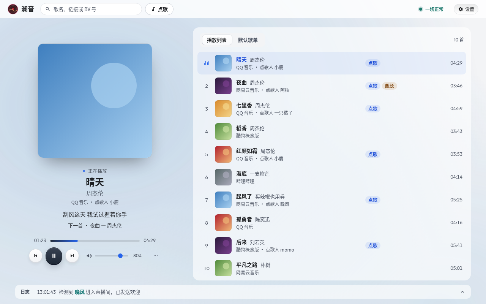
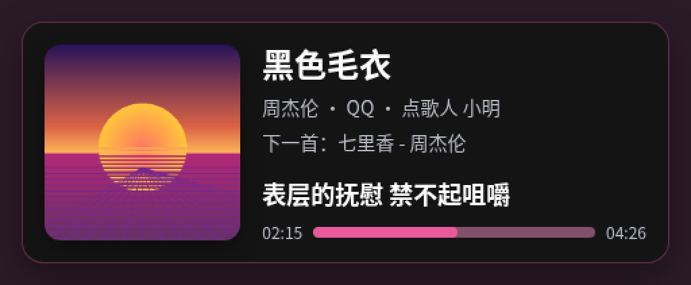
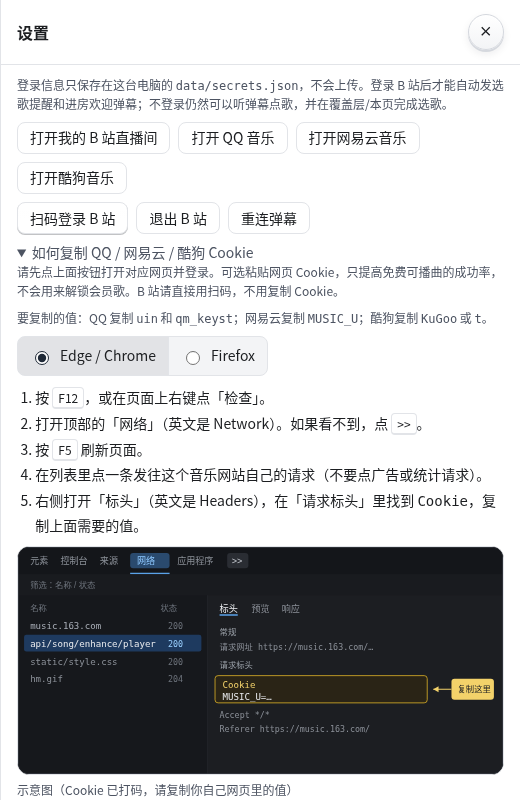
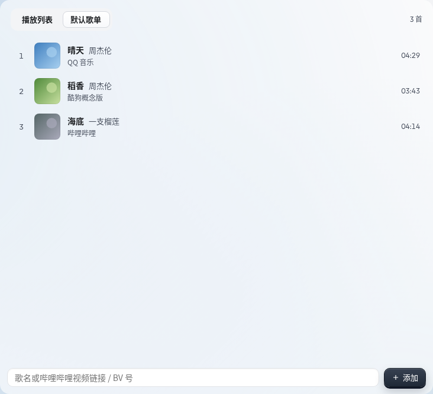
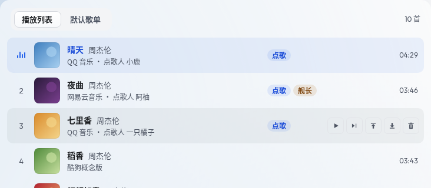

<div align="center">


# 澜音 LanYin

开源免费，一键启动的 B 站点歌姬

观众发弹幕「点歌 歌名」，歌曲进入队列，覆盖层同步展示；<br>
主播用独立控制台管理播放、歌单和设置。不需要会写代码。

[](https://github.com/piwrit04/LanYin/releases/latest)
[](https://www.python.org/downloads/)
[](https://obsproject.com/)
[](https://github.com/piwrit04/LanYin)

**作者**　星澪　·　**仓库**　[github.com/piwrit04/LanYin](https://github.com/piwrit04/LanYin)

</div>



介绍片见 [docs/readme/promo.mp4](docs/readme/promo.mp4)。

本程序**不会**破解会员、不会解密加密音频，也不会走第三方「付费歌换源」接口。登录和 Cookie 只保存在你自己的电脑上。

---

## 目录

- [它能做什么](#它能做什么)
- [准备工作](#准备工作)
- [完整使用教程](#完整使用教程)
  - [1. 下载澜音](#1-下载澜音)
  - [2. 安装 Python](#2-安装-python)
  - [3. 绑进 OBS 并启动](#3-绑进-obs-并启动)
  - [4. 把覆盖层和音频加到场景](#4-把覆盖层和音频加到场景)
  - [5. 填写直播间号](#5-填写直播间号)
  - [6. 扫码登录 B 站（推荐）](#6-扫码登录-b-站推荐)
  - [7. 选填：音乐平台 Cookie](#7-选填音乐平台-cookie)
  - [8. 设置默认歌单](#8-设置默认歌单)
  - [9. 开播后观众怎么点歌](#9-开播后观众怎么点歌)
  - [10. 控制台常用操作](#10-控制台常用操作)
- [音源说明](#音源说明)
- [日常维护](#日常维护)
- [常见问题](#常见问题)
- [给想改配置或跑测试的人](#给想改配置或跑测试的人)
- [版本与后续](#版本与后续)
- [作者](#作者)

---

## 它能做什么

- 弹幕点歌、多结果选歌、撤回；舰长 / 粉丝勋章可优先排队
- 多音源按优先级搜索，可在设置里拖拽调整：QQ 音乐 → 汽水音乐 → 酷狗概念版 → 哔哩哔哩 → 网易云  
  优先原唱，只有试听的会自动跳过
- OBS 覆盖层给观众看（有歌词先显示歌词，没有才显示波谱）；「澜音音频」负责出声
- 独立控制台：播放、切歌、插队、默认歌单、黑名单、主题、欢迎弹幕和文案
- 默认歌单支持歌名，也支持哔哩哔哩视频 / 合集；有人点歌时暂停歌单，点完从暂停处继续
- 记住上次播放的歌和进度；打开时保持暂停，直播间新点的歌仍会立刻播放
- 更新程序时不会覆盖你的设置和登录信息



---

## 准备工作

1. 一台能上网的电脑，**和 OBS 装在同一台最方便**（Windows 推荐；Linux 可用本地启动）
2. 已安装 **OBS Studio**
3. 已安装 **Python 3.11 或更高版本**（见下面第 2 步）

---

## 完整使用教程

按顺序做完，就可以开播点歌。第一次大约需要十几分钟。

### 1. 下载澜音

推荐从发布页下载当前版本（现在是 **1.0.2**）：

1. 打开 [澜音发布页](https://github.com/piwrit04/LanYin/releases/latest)
2. 在页面上方找到 **LanYin-1.0.2.zip**（或「Source code (zip) / 源代码 (zip)」），点进去下载
3. 解压到一个固定位置，例如 `D:\LanYin` 或 `D:\Code\Projects\LanYin`
4. 以后更新时，把新文件复制到同一个文件夹，**不要覆盖**里面的 `config.yaml` 和 `data` 文件夹（你的设置和登录信息在这里）

也可以打开 [仓库主页](https://github.com/piwrit04/LanYin)，点绿色的 **Code** → **Download ZIP**，这会下载主分支上的最新代码。

> 仓库名是 `LanYin`。如果你是从旧目录升级的，本机文件夹也可能仍叫 `obs-song-request` 或 `LanYin-main`，不影响使用。

### 2. 安装 Python

1. 打开 [https://www.python.org/downloads/](https://www.python.org/downloads/)，下载并安装 **3.11 或更高版本**
2. 安装时**务必勾选** *Add python.exe to PATH*（添加到 PATH）
3. 装完后重新打开文件夹窗口，再进行下一步

Linux 用户一般用系统自带的 Python 3 即可，然后用下面的 `start.sh` 启动。

### 3. 绑进 OBS 并启动

推荐把澜音绑进 OBS：打开 OBS 就会在后台启动，不用每次再点 `start.bat`。

**Windows：**

1. **先完全退出 OBS**（托盘里也要退出）
2. 打开澜音文件夹，双击 `bind_to_obs.bat`，按黑色窗口里的提示做完
3. 再打开 OBS → 顶部菜单 **工具** → **脚本** → 左下角 **+**
4. 选中本目录里的 `lanyin.lua`（只需添加这一次）
5. 如果以前加过 `obs_song_request.lua`，先把那条缺失的脚本去掉，再添加 `lanyin.lua`

之后每次打开 OBS，澜音就会在后台运行，并自动弹出控制台窗口（可在脚本设置里取消「启动后自动弹出独立控制台窗口」）。如果窗口没出现，到「工具 → 脚本」里选中澜音脚本，点 **弹出独立控制台窗口**。窗口如果已经开着，会回到原来的窗口，不会再开第二个。停止后再启动，控制台也会重新弹出。

**临时不用 OBS 时：** 也可以双击 `start.bat`。如果 OBS 里的澜音已经在跑，会复用同一个后台，不会再启动一份；关闭 OBS 时，也只会停掉 OBS 自己拉起的那个。

**Linux：**

```bash
chmod +x start.sh   # 只需第一次
./start.sh
```

然后用浏览器打开 http://127.0.0.1:8765/

### 4. 把覆盖层和音频加到场景

澜音**不会**自动往场景里加图层，避免打乱你现有的布局。需要时在脚本窗口点 **把覆盖层和音频加到当前场景**。

| 来源 | 作用 | 说明 |
| --- | --- | --- |
| **澜音覆盖层** | 给观众看的歌名、歌词、队列、选歌提示 | 建议 1920×1080，背景透明，叠在画面上方 |
| **澜音音频** | 真正出声的播放页 | 脚本会设为「监听并输出」；可拖到画布外面，**不要隐藏** |

加好后，你不用另开播放页面，也不用自己去混音器里开监听，就能听到和观众一样的音量。看一眼混音器里「澜音音频」的电平是否在跳动，就能确认有没有声。

也可以手动添加浏览器源：

**覆盖层**

- 来源 → 添加 → **浏览器**
- 地址：`http://127.0.0.1:8765/overlay`
- 尺寸：**1920 × 1080**

如果只想在画面底部显示一条正在播放，可用精简模式：

- 地址：`http://127.0.0.1:8765/overlay?mode=bar`
- 尺寸：**1920 × 220**，放到画面底部

> 精简模式不会显示「请回复序号选歌」的大卡片。经常出现多个候选时，建议用完整的 1920×1080 覆盖层。

**音频（手动时）**

- 再添加一个浏览器源，名称建议叫「澜音音频」
- 地址：`http://127.0.0.1:8765/player`
- 尺寸：320×180 或 800×600 均可，拖到画布外
- **勾选「控制音频通过 OBS」**（英文可能是 Control audio via OBS）
- 保持该源可见（眼睛图标亮着），不要勾选「不可见时关闭」之类会停掉页面的选项
- 在混音器里把它设为 **监听并输出**

### 5. 填写直播间号

1. 打开控制台，点右上角 **设置**
2. 在「直播间号」里填你的 B 站房间号（以后公开发布时填你要绑定的那个房间，不必写死某个号码）
3. 点 **保存设置**，应很快出现「已保存」的提示，并自动重连弹幕
4. 看顶栏状态：弹幕变为已连接，就说明听弹幕正常了

改房间号后一定要再保存一次。端口默认是 `8765`，一般不用改。

### 6. 扫码登录 B 站（推荐）

| | 不登录 | 登录后 |
| --- | --- | --- |
| 听弹幕、搜歌、排队、覆盖层选歌 | 可以 | 可以 |
| 自动发选歌提醒、进房欢迎弹幕 | 不可以 | 可以 |

在控制台的设置 / 登录页点 **扫码登录 B 站**，用手机哔哩哔哩扫码确认即可。

登录信息只保存在这台电脑的 `data/secrets.json` 里，不会进代码仓库，也**不要发给别人**。

欢迎弹幕默认是打开的：有观众进房时会自动发一句短欢迎，措辞会轮换，并按早 / 中 / 晚 / 深夜变化。同一人短时间反复进出不会一直刷屏。

### 7. 选填：音乐平台 Cookie

QQ 音乐、酷狗、网易云若只搜到试听，往往会自动改用哔哩哔哩兜底。把**你自己浏览器里已登录账号**的 Cookie 粘贴到控制台，可以提高这些平台「完整可播」的成功率。

即使粘贴了 Cookie，也只能播放这个账号本来就有权听的歌，不会解锁会员曲。

**复制方法（用开发者工具的「网络 / Network」，不要用旧的 Application 说明）：**

1. 在控制台登录页点对应按钮，打开 QQ / 网易云 / 酷狗并登录
2. 按 <kbd>F12</kbd> 打开开发者工具，切到 **网络**（Network）
3. 按 <kbd>F5</kbd> 刷新页面
4. 在列表里点一条发往这个音乐网站自己的请求（不要点广告或统计请求）
5. 右侧打开「标头 / Headers」，在请求头里找到 `Cookie`，复制需要的值

要复制的关键字段：

- QQ 音乐：`uin`、`qm_keyst`
- 网易云：`MUSIC_U`
- 酷狗：`KuGoo` 或 `t`



Firefox 的步骤几乎一样，只是面板名称可能叫「网络」和「请求头」。控制台登录页里有 Edge/Chrome 与 Firefox 的图文切换。

粘贴后点 **保存**，成功或失败都会有提示。B 站请直接扫码，不用复制 Cookie。

### 8. 设置默认歌单

没人点歌时，可以自动播放你准备好的歌单。

1. 打开「默认歌单」，勾选 **没人点歌时播放默认歌单**，需要的话再勾选 **循环播放**
2. 在输入框里添加，下面这些都可以：
   - 歌名，例如 `晴天 周杰伦`
   - 哔哩哔哩视频或合集链接、BV 号，`https://b23.tv/...` 短链也可以
3. 加入合集后，列表会自动展开为合集里的全部视频



观众点的歌优先：正在播默认歌单时会先暂停歌单；点歌都播完后，从刚才暂停的地方继续。清空队列只清观众点的歌，不会删掉你保存的默认歌单。

### 9. 开播后观众怎么点歌

在直播间发弹幕，下面这些都可以：

- `点歌 晴天`
- `点歌晴天`（中间没有空格也可以）
- `点歌 周杰伦 晴天` 或 `点歌 晴天 周杰伦`

点歌人发 `撤回`，可以取消自己最近一首**还没播放**的歌。正在播放的需要主播在控制台切歌。

**出现多个候选时：** 不会随便挑一首。覆盖层会列出歌名、歌手和来源，点歌人在时限内回复纯数字，例如 `1` 或 `2`。若已登录 B 站，会尽量自动发一条短提醒（普通弹幕大约 20 字），例如：

`@昵称 请回1或2选歌`

完整选项以覆盖层和控制台为准。超时会取消这一次点歌，你也可以在控制台帮观众点选。

### 10. 控制台常用操作

- **播放控制：** 暂停 / 继续、上一首、下一首；进度条可点击跳转；音量可调
- **自己点一首：** 顶栏搜索框输入歌名、链接或 BV 号，点「点歌」
- **播放列表：** 拖拽排序；鼠标移到某一行，可 **立刻播放 / 下一首播放 / 置顶 / 置底 / 删除**
- **更多菜单：** 把当前歌加入默认歌单，或拉黑这首歌
- **黑名单：** 在设置里按用户（UID 或昵称）或歌曲关键词拉黑，被拒绝时会回复一条弹幕
- **优先排队：** 可打开总督、提督、舰长和粉丝牌优先（同级仍按先后，不打断正在播放）
- **主题：** 设置顶部可切换素白、酒夜、粉白、墨金、青瓷
- **弹出窗口：** 把控制台收到独立窗口里，方便和 OBS 并排使用



打开控制台时不会自动播放，会恢复上次的歌曲和进度并保持暂停。直播间里新点的歌仍会立刻播放。

---

## 音源说明

可在设置里拖拽调整顺序。某个源搜不到、只有 30 秒试听、或拿不到完整可播地址时，会自动试下一个。

| 顺序 | 音源 | 状态 | 说明 |
| --- | --- | --- | --- |
| 1 | QQ 音乐 | 需登录 / 视曲目 | 免费且官方给出完整地址才能播；会员或付费若只有试听会跳过 |
| 2 | 汽水音乐 | 占位 | 常见播放地址是加密的，本程序不解密，会跳过并由后面的源兜底 |
| 3 | 酷狗概念版 | 需登录 / 视曲目 | 与酷狗曲库相通；只有官方返回完整播放地址才播 |
| 4 | 哔哩哔哩 | 可用（兜底） | 用官方公开接口，一般不用会员；播的是对应视频音轨，会优先更像原唱的结果 |
| 5 | 网易云音乐 | 需登录 / 视曲目 | 完整地址才播；Cookie 需含 `MUSIC_U` |

---

## 日常维护

- 改房间号、防刷规则（同一观众待播上限、全场队列上限、点歌冷却）后，点 **保存设置**
- 关掉控制台窗口后，声音仍应由 OBS 里的「澜音音频」继续播出。若没声，在脚本里点 **停止澜音**，等一两秒再点 **立即启动澜音**
- 更新澜音时，把新文件复制进原文件夹，**不要覆盖** `config.yaml` 和 `data/`（尤其是 `data/secrets.json`）
- 本机自测、不依赖真实弹幕时，可调用：

```http
POST http://127.0.0.1:8765/api/simulate_danmaku
Content-Type: application/json

{"uname":"测试观众","uid":10001,"text":"点歌 晴天"}
```

---

## 常见问题

**双击 start.bat 一闪而过，或提示没有 Python**  
先安装 Python 3.11+，安装时勾选 Add Python to PATH，然后新开一个文件夹窗口再双击。

**提示端口已被占用**  
用记事本打开 `config.yaml`，把 `port: 8765` 改成别的数字，例如 `18765`，然后重新启动。脚本版会跟着新端口走，并尽量自动改浏览器源地址。

**覆盖层是黑的，或什么都看不到**  
确认地址和端口正确、澜音正在运行、浏览器源尺寸足够大。没人点歌、队列为空、又没有开启默认歌单时，覆盖层会自动隐藏，这是正常的。

**能排队但没有声音，或关掉控制台就没声了**  
声音应该来自 OBS 的「澜音音频」，不是控制台窗口。请确认：这个源已加到当前场景、没有被隐藏、已设为「监听并输出」，并勾选了「控制音频通过 OBS」。若仍无声，在脚本里点「停止澜音」再「立即启动澜音」，让音频页重新接通。

**不能自动发弹幕（选歌提醒或进房欢迎）**  
在控制台扫码登录 B 站，并确认已打开欢迎相关开关。未登录时，选歌提示仍会显示在覆盖层和控制台。

**很多歌都跳到哔哩哔哩了**  
通常是因为前面的音乐平台对这首歌只提供试听，或需要会员。这是预期行为，不是故障。

**停止澜音后再启动，控制台窗口没有出来**  
请使用 1.0.1 或更新版本。在「工具 → 脚本」里选中澜音，点 **弹出独立控制台窗口**。从 1.0.1 起，停止后再启动会重新自动弹出。

**脚本重新加载之后，设置好像没保存成功**  
请使用当前版本的脚本。重新加载时应先关掉 OBS 启动的旧后台，再拉起新的。若仍提示超时，先点「停止澜音」，等一两秒再点「立即启动澜音」。

---

## 给想改配置或跑测试的人

| 路径 | 说明 |
| --- | --- |
| `config.yaml` | 房间号、音源顺序、欢迎与歌单等（不含登录凭证） |
| `data/secrets.json` | 登录与 Cookie，已被 Git 忽略，**不要提交、不要分享** |

```bash
python3 -m venv .venv
source .venv/bin/activate   # Windows: .venv\Scripts\activate
pip install -r requirements.txt
python -m pytest tests
python -m app
```

---

## 版本与后续

- 当前发布版：**1.0.2**（控制台构建 45）
- 下载地址：[github.com/piwrit04/LanYin/releases/latest](https://github.com/piwrit04/LanYin/releases/latest)
- 推荐用法是 OBS **脚本版**（`lanyin.lua`）
- 原生停靠插件会另作发布，不包含在本目录的日常使用流程里

---

## 作者

**星澪**

- GitHub：[@piwrit04](https://github.com/piwrit04)
- 项目仓库：[LanYin](https://github.com/piwrit04/LanYin)

欢迎 Star、提 Issue。使用中遇到问题，优先附上控制台日志里相关的几行，会更好排查。
